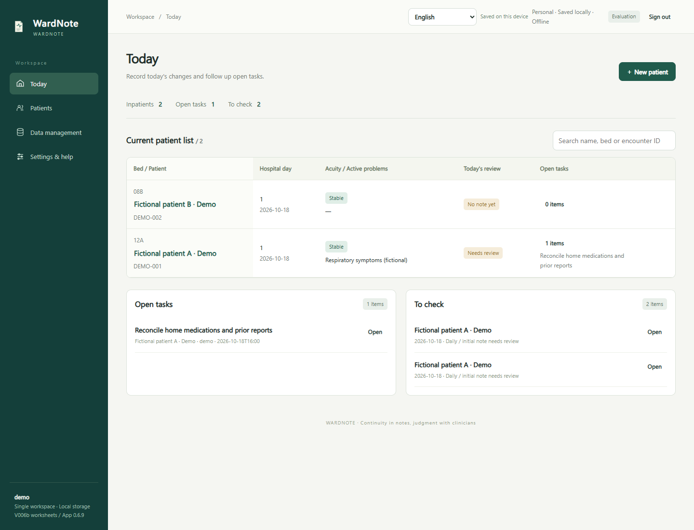

# WardNote

[中文](README.md) · [Deployment](docs/DEPLOYMENT.md) · [Validation](docs/VALIDATION.md) · [Bilingual GitHub introduction](docs/GITHUB-INTRO.md) · [Clinical workflow boundaries](docs/CLINICAL-SCOPE.md)

A lightweight, portable ward-round worksheet for daily notes and patient follow-up. Text entry is the primary workflow; recording is optional assistance.

**v0.6.15 — initial pre-release, including UI r1.** The UI supports Chinese, English, Spanish, French, Russian, Arabic, Hindi and Urdu, including right-to-left Arabic/Urdu layouts. Initial history and daily review retain the paired V006 Chinese b / English V006b worksheet structure. The public package includes the English paper templates. Interface switching preserves clinical source text; report language is independent. New translations await native clinical review, and speech capabilities require separate validation: see [language support](docs/LOCALIZATION.md). Start with synthetic cases. Hospital production deployment, clinical speech accuracy and educational outcomes have not been validated.

### Three entry points (0.6.15)

- **Windows computer:** extract `wardnote-0.6.15-portable-win-x64.zip` and double-click `Start-WardNote.cmd`. The launcher opens the browser and provides reopen, help, an optional desktop shortcut, and stop after confirmation. The original Chinese launcher remains available.
- **Phone browser:** a deployment owner first prepares a dedicated trusted HTTPS address using `wardnote-0.6.15-static-pwa.zip` and its offline setup wizard. Clinicians then open the link without installing Node or models or entering API keys. This static edition has no server synchronization or cloud transcription endpoints.
- **PWA:** use the browser's installation or home-screen option when available. Eight-language guidance, device checks and safe launch-link sharing are available before login and in Settings. Browser use remains available without installation.

**Safe update prompts:** automatic checks contact the same app address, with manual checks on the sign-in and Settings pages; users choose when to save and update, without forced refresh during recording or unfinished work. [Updates and older cached pages](docs/OFFLINE-AND-ACCOUNTS.md)

[Start here (offline help)](开始使用.html) · [Personal and administrator setup](docs/EASY-DEPLOYMENT.md). The workflow takes inspiration from Headache Diary's separate entry paths, stable address and repeated-launch protection, implemented for WardNote's offline default and device isolation. Verify an encrypted backup before changing address, browser or device; sharing sends only the app launch link.

## Lightweight deployment and easy access

**One-click Windows launch, direct browser access and a PWA entry point.** The separate Windows x64 offline portable package includes verified Node.js 24.19.0: extract it and double-click the launcher, without separately installing Node or running npm online. The small source package requires Node.js 24+. Basic notes need no dedicated client, model or API key. The source, Windows portable and static PWA packages each include usage and deployment instructions; environment and storage requirements depend on the selected package.

Phone access still requires reachable, trusted HTTPS deployment; installation options vary by browser and platform. Physical-phone installation, standalone PWA mode and background/lock-screen recording remain unvalidated. This is not a claim of zero-configuration deployment on every platform. Offline is the default; identical account names on different devices do not automatically synchronize data.

After initial preparation, core text notes work independently offline, reducing dependence on an EHR or continuous internet access. A compatible browser, sufficient storage/memory and power are still required. Low-resource devices, intermittent networks and shared terminals are planned for voluntary feedback after authorized publication; suitability across all regions has not been established. [Conditions and follow-up](docs/ROADMAP.md)

The application includes device/offline readiness checks, recording-capacity notices and critical-capacity protection, account-scoped backup status, and date-order, time-zone, digit-display and A4/Letter preferences. Unknown capacity is reported as unknown. Download offered, folder write completed and backup verified are separate states. Regional preferences change display only, preserving source text, lab values, doses and units. [Infrastructure choices and limits](docs/INFRASTRUCTURE.md).

[Getting started in eight languages](docs/GETTING-STARTED.md) · [Deployment requirements](docs/DEPLOYMENT.md)

[Release readiness and follow-up](docs/RELEASE-CHECKLIST.md) · [Fictional workflow demo](docs/DEMO.md)

Version 0.6.12 adds safe update prompts and encrypted segmented backups. Working pages are not forcibly switched to a prepared release; save work and end recording first. Larger audio collections can be saved in parts, verified by selecting the saved files again, and restored into a new account. Legacy JSON restore remains available. See [offline/backup steps and limits](docs/OFFLINE-AND-ACCOUNTS.md) and the [actual validation report](docs/VALIDATION.md).



## Product focus

Daily notes open by default inside one patient workspace with Clinical notes, Review and handoff, and Decision reflection sections. The dashboard retains cross-patient queues. Previous notes are available for comparison without automatic copying. The clinical sections are History & background, Daily review, Clinical course, and Tests & results. Full memo tools are embedded below the patient brief. Voice and Tasks remain patient-scoped floating panels. Daily review retains a task shortcut; the course timeline links important memos. Desktop panels can be dragged or docked; phones show one bottom panel at a time.

This project is not intended to become a full EMR: prescribing, billing, scheduling and hospital administration are outside its scope. Linked learning reflections remain patient-associated information, but are excluded from clinical exports and handoff summaries.

**Individual identity authorization, access control and attributable audit oversight are the hospital/institution's responsibility, outside this product's administration scope.** The institution must verify its controls cover the app's data, audio, exports and backups. Existing password, encryption, locking and revision safeguards remain. Institution-approved pseudonyms and minimum necessary identifiers can reduce exposure; pseudonymization alone is not de-identification or permission to send data externally. See [clinical boundaries](docs/CLINICAL-SCOPE.md).

Stage summaries separately show an as-of snapshot of all currently outstanding work, including tasks created outside the selected narrative period and their next steps/contacts. Changed sources or pending-task membership require regeneration and review; stored summaries are not rewritten. Entering a discharge date with open tasks prompts follow-up responsibility without blocking the save or completing those tasks.

The dashboard shows a bed-sorted patient table with hospital day, problems from the latest note, today's review status and open tasks. Search by name, bed or encounter ID. Admission day counts as day 1. The daily trend table displays up to three entered observations for each metric/unit through the selected note date, retaining source-report verification status.

Switch language on the sign-in screen or workspace header. Saving is checked before switching; failed saves block switching. Recording can continue within the same patient; changing patient requires ending and saving it. The browser stores encrypted clinical records, audio and history in a device workspace, with separate stores for personal and institutional modes. Language and panel positions remain preferences. UI switching never translates clinical content. Optional model-generated candidates and summaries use a separately selected report language and require review. A separate initial-vitals field is additive; older examination text remains unchanged.

Clinical status options are Stable, Seriously ill and Critically ill. Legacy attention flags require clinician reassessment. Tasks and pending results share To follow up / Done.

See [model interfaces](docs/MODEL-INTERFACES.md) for disabled-by-default text provider profiles and the separate speech adapter contract. Native vendor ASR accuracy and real credentials have not been validated.

## Workflow

- Separate initial assessment, longitudinal background and daily review.
- Document evidence, alternatives, plans, monitoring and escalation conditions.
- Track lab provenance and tasks; preserve revisions and detect conflicting edits.
- Record audio, replay it and preserve independent important clips.
- Review transcript classification before inserting text into a note.
- Link summaries to source versions and invalidate approval when sources change.
- Record clinician review and scoped patient participation separately.
- Evaluate audio retention manually; unresolved patient corrections and protected audio prevent cleanup.
- Export encounter JSON, lab CSV, an email draft or an A4/Letter printout; save a multipart encrypted backup.

## Run locally

**Windows x64 offline portable package:** extract the complete `wardnote-0.6.15-portable-win-x64.zip` and open `Start-WardNote.cmd` (the original `启动应用.cmd` remains a fallback). Keep the same browser and address; run the device check in Settings before first use. The downloaded package can be copied by offline media. Patient data require a separate encrypted backup and manual restore.

**Source package:** install **Node.js 24+**, download/extract the source and run from the project root:

```sh
node app/server.mjs
```

Visit **http://127.0.0.1:8787**, create a username and workspace password and optionally load the fictional demo cases. Running the application requires no npm installation, model download or API key. Device data live in encrypted browser storage. Server data remain in `data/` for personal mode and `data/institution/` for institutional mode. Server provisioning is restricted to the server computer. Device workspace setup follows initial application-resource preparation. See [offline operation and accounts](docs/OFFLINE-AND-ACCOUNTS.md) for migration, backups and authorization recipients.

On Windows, use `Start-WardNote.cmd` and stop through its launcher panel. The original `启动应用.cmd` / `停止应用.cmd` remain fallback entry points. End recording and wait for saves before stopping. With foreground terminal startup, use Ctrl+C.

## What is and is not implemented

Recording, playback, independent clips, structured notes, review, source versions and controlled cleanup are implemented. Speech recognition is an **adapter requiring an explicitly configured service**, with no speech engine enabled by default. Classification uses explicit line-prefix rules and human confirmation. Summaries aggregate existing material without diagnostic inference.

The mobile layout and PWA resources are provided. A phone needs a trusted HTTPS deployment; localhost on a phone does not reach your computer. Keep recording in the foreground. Prepared device workspaces support offline clinical editing, local audio and restart recovery. Continuous background or lock-screen recording remains unvalidated.

Personal and institution/hospital modes have isolated workspaces. Sign out before changing mode. Each new connection requires a separate password and explicit confirmation; authorization destinations are unconfigured by default. It has no institutional SSO/RBAC or certified electronic signatures. EHR/LIS integration and FHIR mappings require site-specific work. A patient's participation is documented by the clinician, not independently authenticated in a patient portal.

## Test

No packages are needed for core and release checks:

```sh
cd app
node --test tests/*.test.mjs
```

Browser tests:

```sh
npm ci
npx playwright install chromium
npm run test:browser
```

Use `npx playwright install --with-deps chromium` when Linux system libraries are missing, or set `NOTE_BROWSER` to an existing compatible browser executable. Test output goes to `work/qa/`; fixtures and microphone input are synthetic. Temporary browser profiles and databases are cleaned up.

The CI workflow defines core checks on Windows, Linux and macOS plus a Chromium workflow on Linux. It has not run on GitHub until an actual repository executes it. See [validation status](docs/VALIDATION.md) and [release preparation](docs/RELEASING.md).

## Documentation and contribution

[Architecture](docs/ARCHITECTURE.md) · [Deployment and adapters](docs/DEPLOYMENT.md) · [Evaluation plan](docs/EVALUATION.md) · [Roadmap](docs/ROADMAP.md) · [Contributing](CONTRIBUTING.md) · [Security](SECURITY.md)

Do not submit patient information, recordings, credentials or private institutional configuration in issues, pull requests or screenshots. Source-available publication does not authorize exporting clinical data.

## License

Project-authored code, templates and documentation use the [WardNote Personal Noncommercial Source-Available License](LICENSE). Independent personal learning and experimentation are permitted within its terms. All institutional and commercial use, including nonprofit internal evaluation, teaching and research, requires prior explicit written authorization from **Junhui Liu M.D.** Contact [junhuiliu1025@gmail.com](mailto:junhuiliu1025@gmail.com), or the official GitHub repository once published.

This is not an OSI-approved open-source license. Earlier valid Apache-2.0 / CC BY 4.0 grants and third-party licenses remain unaffected. Scope and any fees are agreed separately. See the [licensing policy](LICENSES/README.md).

The educational design supports ongoing supervision and reflection; no fixed-period improvement claim is made.

Physical-device, first-time-user, clinician and native-language checks are planned as voluntary synthetic-case feedback after the owner separately authorizes public pre-release. No publication or recruitment occurs in this preparation. Institutional and commercial evaluation still requires written permission. [Short feedback plan](docs/EVALUATION.md)

This release adds source passages and optional timed replay for reviewed candidates, a collapsible pre-round review, and task completion evidence. Encrypted original recordings are retained. See the [named design references](docs/CLINICAL-SCOPE.md).

### 0.6.3 interface simplification

Voice opens from the patient tool rail; the duplicate record-toolbar shortcut is removed. More opens an edge drawer for teaching prompts, retrying saves, exporting a draft and the selected record history. Close, Escape and backdrop dismissal restore focus. Mobile and RTL layouts are supported; recovery actions remain accessible after save failures and sign-out clears the drawer.

### Patient brief

The patient banner adds a collapsible four-item brief with local extraction, manual editing, source excerpts, timestamps and explicit clinician review. Source changes flag the brief for regeneration and review. A separate memo fold links to existing records. See [patient brief behavior](docs/PATIENT-BRIEF.md).

## Username sign-in and embedded memos

Multiple local accounts have separate encrypted stores; sign out before switching accounts or personal/institutional mode. An older workspace can be linked to a chosen username using its existing password without moving clinical records. Full text and audio memo tools now sit below the patient brief; the duplicate floating memo entry is removed. These local accounts do not establish hospital SSO or staff roles.

Start recording in the memo section records locally; explicitly requested transcription uses a configured service. Reviewed text becomes a separate memo with its original recording and provenance retained. See [voice memos](docs/PATIENT-BRIEF.md).

### 0.6.7 Dictation routing

Confirm the patient and recording arrangements; supplemental details are optional. Explicit headings such as “Memo:” suggest clinical sections, memos, tasks, complete lab fields or reflections. Review each candidate before atomic append. Source audio and quotes remain available; unclear destinations stay unassigned. See the [voice workflow](docs/PATIENT-BRIEF.md).

## Reference sources, purpose and copyright

Drawing on selected principles from the referenced frameworks, this tool supports initial assessment, inpatient care, and the learning and teaching of clinical reasoning and patient management. It does not replace official hospital or institutional records, orders, management systems or governance responsibilities.

[China’s National Health Commission: 18 core medical quality and safety systems](https://www.nhc.gov.cn/zwgk/jdjd/201804/5dfb30387c74412194c7f05b878d4f87.shtml); [US CMS: Conditions of Participation for Hospitals](https://www.cms.gov/medicare/health-safety-standards/conditions-coverage-participation/hospitals); [US Joint Commission: National Patient Safety Goals / National Performance Goals](https://www.jointcommission.org/en-us/standards/national-performance-goals); [US ACGME: Common Program Requirements for Residency](https://www.acgme.org/programs-and-institutions/programs/common-program-requirements/); [UK NICE: Acutely ill adults in hospital — recognising and responding to deterioration](https://www.nice.org.uk/guidance/CG50/chapter/recommendations); [UK NHS England: National Safety Standards for Invasive Procedures (original edition)](https://www.england.nhs.uk/patient-safety/natssips/); [UK CPOC: National Safety Standards for Invasive Procedures (second edition)](https://www.cpoc.org.uk/guidelines-and-resources/guidelines/national-safety-standards-invasive-procedures-natssips); [Germany’s G-BA: Quality Management Directive](https://www.g-ba.de/richtlinien/87/).

Edition note: the NPG chapter replaced NPSGs for Joint Commission hospital and critical access hospital programs on 1 January 2026. NHS England published NatSSIPs in 2015; CPOC published NatSSIPs 2 in 2023. Referencing these frameworks does not imply institutional endorsement, accreditation or compliance with all requirements.

© Junhui Liu M.D.

Copyright attribution does not change the existing license: personal noncommercial use is subject to the project license; institutional and commercial uses require the author’s prior written permission. Earlier lawful grants and third-party rights remain unaffected.

[Full notice in eight languages](docs/PROJECT-NOTICE.md)

## Independent use and continuity

Independent use comes first; external connections are optional. After initial offline preparation, notes, comparisons, review and local backups do not require an EHR/HIS, cloud model or internet. Hospital integration is an optional extension, not a prerequisite.

Optional changes-since-last-round comparison and local SBAR drafts preserve source times, missing-entry warnings and manual review. Edits clear review; the dedicated copy action rejects stale sources. [Workflow and boundaries](docs/CONTINUITY.md).

Bed-ordered patient switching, shared unfinished tasks in handoff, and direct navigation from source previews now support the existing offline workflow. Personal phrases, medical speech adapters and hospital interfaces remain conditional [future directions](docs/ROADMAP.md).


Optional transcription, model, synchronization and external integration features described here require the full backend edition and their separate configuration/authorization. The static PWA edition has no such APIs.
