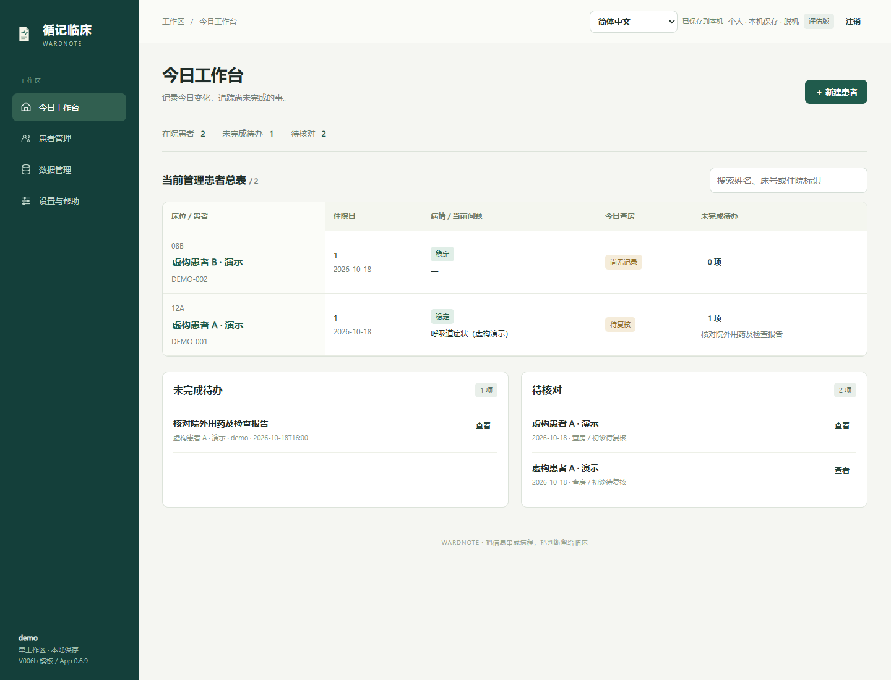

# WardNote · 循记临床

[English](README.en.md) · [使用与部署](docs/DEPLOYMENT.md) · [验证范围](docs/VALIDATION.md) · [纸质模板](templates/README.md) · [GitHub 中英文简介](docs/GITHUB-INTRO.md)

**便携查房记录与单患者持续追踪 PWA。** 从原始住院记录表出发，优先帮助医生记录今日变化、查看前次记录并追踪未完成事项。文字记录为主，语音为按需使用的辅助。

**v0.6.15 · 首次预发布版本（包含 UI r1）。** 界面支持中文、英语、西班牙语、法语、俄语、阿拉伯语、印地语和乌尔都语，包含阿拉伯语／乌尔都语从右向左布局。初诊与查房仍基于 V006中文b / V006b 纸表；公开包保留英文纸表。界面切换保留患者原文，报告语言单独指定。新增译文尚待母语临床人员复核，语音服务能力需单独验证，详见[语言支持说明](docs/LOCALIZATION.md)。适合先用虚构资料评价工作流程，尚未完成医院生产部署、真实语音准确率或临床教育成效验证。

### 三种使用入口（0.6.15）

- **Windows 电脑**：下载并解压 `wardnote-0.6.15-portable-win-x64.zip`，双击 `Start-WardNote.cmd`。启动面板自动打开浏览器，提供重新打开、开始使用、手动创建桌面快捷方式及确认后停止。也保留原中文启动入口。
- **手机浏览器**：管理员先使用独立的 `wardnote-0.6.15-static-pwa.zip`，按离线向导配置专用可信 HTTPS 地址；临床使用者打开地址即可进入本机工作区，无需安装 Node、模型或填写接口密钥。静态版不提供服务器同步或云端识别接口。
- **PWA**：同一地址可按浏览器提示安装或添加到主屏幕；登录前和设置中均有八语言引导、设备检查及安全链接复制／分享入口。未提供安装按钮时仍可使用浏览器。

**安全更新提示：** 自动检查同一地址的程序更新，也可在登录页或设置中手动检查；由使用者选择保存并更新，录音或未完成操作期间不会强制刷新。[更新与旧缓存处理](docs/OFFLINE-AND-ACCOUNTS.md)

[从这里开始（可离线打开）](开始使用.html) · [个人与管理员部署说明](docs/EASY-DEPLOYMENT.md)。借鉴 Headache Diary 的分入口说明、固定地址及重复启动保护，按 WardNote 默认脱机和设备隔离要求重新实现。更换网址、浏览器或设备前须核验加密备份；分享的仅是程序入口链接。

## 轻量部署与便捷访问

**Windows 一键启动、浏览器直接使用与 PWA 入口。** 独立 Windows x64 离线便携包包含已核验的 Node.js 24.19.0，解压后可双击启动，无需另装 Node 或在线运行 npm；普通源码包保持轻量，需先安装 Node.js 24+。基础记录无需另装客户端、模型或 API 密钥。源码、Windows 便携、静态 PWA 三类包均附相应用途与部署说明；运行环境和存储要求因所选包而异。

手机使用仍需部署可访问的可信 HTTPS；安装入口依浏览器和平台而异。真实手机安装、独立 PWA 模式及后台／锁屏录音尚待验证，不代表所有平台零配置。默认脱机，不同设备同名账号不会自动同步资料。

核心文字记录完成首次准备后可独立脱机使用，有助于适应缺少 EMR 或持续网络的环境；仍需兼容浏览器、足够存储与内存及供电。低资源设备、弱网和共享终端的适用性将纳入获准发布后的自愿体验反馈，目前不声称在所有地区均已验证。[适用条件与后续反馈](docs/ROADMAP.md)

当前已提供设备与脱机准备自检、录音容量提示与临界停止保护、当前账号的备份状态，以及日期顺序、时区、数字显示和 A4/Letter 纸张设置。容量未知会如实显示；“提供下载”“文件夹写入完成”“核验通过”分别记录。地区设置只调整显示，不改写病历原文、化验值、剂量或单位。[不同基础设施下的使用与边界](docs/INFRASTRUCTURE.md)。

[开始使用与八语言说明](docs/GETTING-STARTED.md) · [部署前提](docs/DEPLOYMENT.md)

[发布准备与后续验证](docs/RELEASE-CHECKLIST.md) · [中英文虚构病例演示](docs/DEMO.md)



## 使用主线

进入患者后默认打开每日查房。在同一患者工作区内切换「诊疗记录」「核对与交接」「决策复盘」；工作台保留跨患者待办与核对总览。诊疗分区依次为「初诊与背景—每日查房—病程记录—检查与化验」。备忘完整列于患者摘要下方，可收起展开；语音与待办通过两个浮窗按需展开；每日查房保留待办入口，病程保留重要备忘来源索引；带教提示按需展开，前次记录仅供对照，不自动复制为今日发现。

项目以简洁、便携、低记录负担为优先，不以建设完整EMR为目标。医嘱开立、收费、排班及复杂医院管理模块不在当前范围。学习复盘与临床记录用途分开；复盘关联患者后按可关联患者资料保存，但不进入临床导出或交接摘要。

本产品记录工作摘要和跟进事项；正式医嘱、审批、签署、权限及制度执行由医院承接。危急结果和监测计划通过现有栏位手动记录，不新增管理模块。详见[临床工作边界与制度分工](docs/CLINICAL-SCOPE.md)。

**个人身份授权、访问控制和可追溯操作的管理属于医院/机构职责，不在本项目管理模块范围内。** 机构须核实其措施覆盖本工具的资料、录音、导出和备份；本次保留已有密码、加密、锁定及修改历史。可按院规使用化名或最少必要标识；化名化不等于完成去标识化，也不自动授权外发资料。

阶段摘要另列带时间的当前未完成事项，包括日期范围外的遗留任务及下一步/联系方式。来源或待办清单变化后需重新生成并核对，旧摘要不自动改写。填写出院日期时，如仍有待办会提示安排后续责任；提示不阻止保存，也不自动关闭任务。

工作台以床位排序的患者总表显示住院日、最近记录的问题、今日记录状态和未完成待办，支持姓名、床号和住院标识搜索。住院日按入院日为第1日计算；数据趋势按当前查房日期显示同指标、同单位的最近三次已录入结果，原报告核对状态保留。

登录页与顶部均可切换语言。切换会保留所选患者、记录和原文；保存失败时先保留当前页面；录音可在同一患者内切换分区，切换患者须先结束并保存。本机工作区把患者资料、录音和修改历史加密保存在浏览器内，默认脱机；界面语言和浮窗位置单独作为偏好保存。切换界面不翻译已输入文字、原始转写、既有摘要和导出记录。报告语言可另选，生成其他语言需启用文本模型并核对候选。初诊首次独立提供生命体征栏，旧版查体中的内容仍原样保留。

病情状态提供「稳定／病重／病危」，英文对应 Stable / Seriously ill / Critically ill。旧版关注/优先级标记显示待重新确认，不自动推定为正式病情判定。待回报与普通待办都只使用「待跟进／已完成」。

接口及启用条件见[模型接口](docs/MODEL-INTERFACES.md)。文本模型默认关闭，语音仍为独立可配置服务；尚未使用真实厂商凭据验证识别准确性。

## 能够做什么

- 初诊、住院背景与每日记录分别维护；记录判断依据、替代解释、主要计划和升级条件。
- 管理关键检查、负责人和待办；保存失败或版本冲突时保留当前页面草稿。
- 保存原始录音、回听并独立保存重要片段；转写文本经人工确认后追加到相应分区。
- 汇总已有资料并记录来源版本；来源改变后提示重新核对。
- 区分医生复核与患者对经历、偏好和计划理解的核对；记录分歧及处理结果。
- 对普通录音进行人工清理资格检查；重要材料和未处理的核对意见会阻止清理。
- 提供分卷加密备份、单次住院 JSON、检验 CSV、邮件草稿和 A4/Letter 打印。

0.6.12 补充安全更新提示与分卷加密备份：已有页面工作时不强制切换新版，先保存并结束录音；较多录音可按卷保存，再重新选取文件核验并恢复到新账号。旧版 JSON 仍可恢复。回退兼容性、首次升级步骤及容量限制见[脱机与备份说明](docs/OFFLINE-AND-ACCOUNTS.md)，实际检查结果见[验证报告](docs/VALIDATION.md)。

## 本机启动

**Windows x64 离线便携包：** 完整解压 `wardnote-0.6.15-portable-win-x64.zip`，双击 `Start-WardNote.cmd`（原中文入口 `启动应用.cmd` 作为备用）。保持原浏览器及固定地址，首次开始前可在设置中运行设备自检。首次下载后可通过离线介质复制程序包；患者资料需另行加密备份和手动恢复。

**源码包：** 安装 **Node.js 24 或以上**，下载本仓库源码并解压。在项目根目录执行：

```sh
node app/server.mjs
```

打开 **http://127.0.0.1:8787**，创建账号并设置工作区密码，再选择“载入虚构演示病例”。应用运行不需要安装 npm 依赖、下载语音模型或申请 API 密钥。

Windows 优先双击 `Start-WardNote.cmd`，也保留中文备用入口 `启动应用.cmd`。关闭浏览器不会停止后台服务；先结束录音并确认保存，再从启动面板停止，或运行 `停止应用.cmd`。终端前台启动则用 Ctrl+C 停止。

本机资料保存在当前浏览器的加密工作区，个人和机构模式下各账号分别保存；服务器个人资料位于 `data/`，机构资料位于 `data/institution/`。默认脱机，每次联网须独立密码确认。服务器首次初始化仅限服务器本机，本机浏览器工作区则在页面资源准备好后创建。迁移旧版资料、两类备份及授权接收端配置见[脱机与账号说明](docs/OFFLINE-AND-ACCOUNTS.md)。

## 功能状态

文中语音识别、模型、同步及外部接口等可选服务仅适用于完整后端版，须分别配置并授权；静态 PWA 版不提供这些接口。

| 能力 | 当前状态 |
| --- | --- |
| 文字记录、审核、来源追溯、录音与重要片段 | 已实现，使用虚构资料测试 |
| 自动语音转写 | 接口已实现；需要配置获准的语音服务，默认没有真实识别引擎 |
| 文字归类 | 按明确段首标签提供建议，须人工确认；不是通用医疗 NLP |
| 阶段汇总 | 汇集已有记录并保留来源，不自动诊断或生成治疗建议 |
| 手机页面与安装资源 | 已提供；手机录音/安装需受信任 HTTPS，尚无真机认证 |
| 脱机记录与本地录音 | 支持加密保存、重启解锁和已保存片段恢复；后台／锁屏连续录音未验证 |
| 个人／机构模式 | 登录页区分，注销后切换；每次联网独立密码授权，接收端默认待配置 |
| 医院 EHR/LIS 对接 | 提供可配置 JSON 接收接口；未完成真实医院适配或 FHIR 映射 |
| 机构身份、多人权限、审计管理、正式电子签章 | 由医院/机构承接，不建设相应管理模块；当前支持本机多账号隔离，不提供医院统一身份或角色管理 |

源码公开不意味着患者数据公开。默认仅监听本机；数据、音频和密钥不属于发布包。医疗机构的权限、访问、录音授权及保留规则仍需具体部署方确定。

## 复现测试

核心与发布检查不需要第三方依赖：

```sh
cd app
node --test tests/*.test.mjs
```

浏览器检查使用锁定的开发依赖：

```sh
npm ci
npx playwright install chromium
npm run test:browser
```

Linux 若缺少浏览器系统库，使用 `npx playwright install --with-deps chromium`。也可用 `NOTE_BROWSER` 指定已有 Chrome/Edge。测试仅使用虚构病例与模拟麦克风；结果写入 `work/qa/`，临时数据库和浏览器目录会清理。

CI 配置包含 Windows、Linux、macOS 核心测试和 Linux Chromium 浏览器测试。**提供配置不代表已经在 GitHub 上运行通过**；当前本机结果及待验证范围见 [验证说明](docs/VALIDATION.md)。

## 项目结构

```text
app/          应用、服务、测试；无运行时第三方依赖
templates/    可公开的 V006/V006b 纸质模板
docs/         部署、接口、设计、验证与评估计划
scripts/      发布文件清单检查与独立发布目录生成
.github/      自动化检查、问题及贡献模板
data/         本地运行数据，不纳入版本控制
work/         本地验证产物，不纳入版本控制
```

贡献请阅读 [CONTRIBUTING](CONTRIBUTING.md)；漏洞请按 [SECURITY](SECURITY.md) 私下报告。请勿向 issue、PR、截图或演示环境提交真实患者信息、录音或服务凭据。

## 许可

代码、项目模板与文档采用自定义[个人非商业源码可见许可](LICENSE)。独立个人学习／实验可在许可范围内使用；所有机构及商业用途（包括非营利机构内部试用、教学与研究）须事先取得 **Junhui Liu M.D.** 的明确书面授权。联系：[junhuiliu1025@gmail.com](mailto:junhuiliu1025@gmail.com)，或发布后的官方 GitHub 仓库。

本许可不属于 OSI 开源许可；旧版已授予的 Apache-2.0／CC BY 4.0 权利及第三方许可不受影响。授权范围与费用另行约定，详见[使用与授权政策](LICENSES/README.md)。

临床训练是持续带教和反思过程，本项目不承诺在固定天数内提升能力。后续工作见 [路线图](docs/ROADMAP.md) 与 [版本记录](CHANGELOG.md)。

真实手机、首次使用、临床人员和母语审校等验证，按计划在作者另行授权公开预发布后邀请用户自愿体验并综合反馈；本轮不实际发布。反馈只使用虚构资料，机构及商业评估仍须书面许可。[简版反馈计划](docs/EVALUATION.md)

本轮新增候选原文依据与按可用时间位置回听、可折叠的查房前核对及待办完成依据；原始录音继续加密保存。制度名称及官方出处见[设计参考来源](docs/CLINICAL-SCOPE.md)。

### 0.6.3 界面简化

查房与初诊工具栏移除重复的“语音辅助”，语音仍从页面边缘的“语音”入口展开。“更多”改为侧边抽屉，保留带教提示、重试保存、草稿副本和当前记录的修改历史。支持关闭按钮、Esc、点击背景收起；手机与从右向左语言保持可用。保存失败时仍可导出草稿，注销会清除侧栏信息。

### 患者摘要

患者信息区新增可收起的四项速览：就诊原因、既往重点、最近状态、当前重点。按需在本机提取，可人工修改，医生核对后保留核对人与时间；来源变化会提示更新并要求重新核对。备忘独立列于下方，引用同一份原记录。详见[患者摘要说明](docs/PATIENT-BRIEF.md)。

## 账号登录与完整备忘

登录页使用账号＋密码，支持新建多个本机账号；注销后才能切换用户或个人／机构模式。旧工作区首次登录可输入新账号名和原密码，绑定并保留原资料。备忘区域已包含全部文字及音频操作，右下角移除重复的备忘按钮。详见[账号与迁移说明](docs/OFFLINE-AND-ACCOUNTS.md)。

备忘区支持“开始录音”：本机录音后，按需调用已配置识别服务，核对文字再保存为独立备忘，保留原声与来源。详见[语音备忘](docs/PATIENT-BRIEF.md)。

### 0.6.7 口述分区

录音补充说明选填，确认患者后可直接开始。口述“备忘：…”等明确标题可生成对应分区候选；经核对后追加至初诊、背景、查房、备忘、待办、完整检查字段或复盘。保留原声和引用，未知内容不强行归类。详见[语音流程](docs/PATIENT-BRIEF.md)。

## 参考来源、用途与版权

本工具参考相关框架中的部分原则，用于辅助初诊评估和住院患者管理，并支持临床思维与患者管理能力的培养和教学；不能替代医院／机构的正式病历、医嘱、管理系统或管理职责。

[中国国家卫生健康委员会：医疗质量安全核心制度要点（十八项核心制度）](https://www.nhc.gov.cn/zwgk/jdjd/201804/5dfb30387c74412194c7f05b878d4f87.shtml)；[美国 CMS：医院参与条件](https://www.cms.gov/medicare/health-safety-standards/conditions-coverage-participation/hospitals)；[美国 Joint Commission：国家患者安全目标／国家绩效目标](https://www.jointcommission.org/en-us/standards/national-performance-goals)；[美国 ACGME：住院医师培训通用项目要求](https://www.acgme.org/programs-and-institutions/programs/common-program-requirements/)；[英国 NICE：住院急性病成人患者病情恶化的识别与响应](https://www.nice.org.uk/guidance/CG50/chapter/recommendations)；[英国 NHS England：侵入性操作国家安全标准（原版）](https://www.england.nhs.uk/patient-safety/natssips/)；[英国 CPOC：侵入性操作国家安全标准（第二版）](https://www.cpoc.org.uk/guidelines-and-resources/guidelines/national-safety-standards-invasive-procedures-natssips)；[德国 G-BA：质量管理指令](https://www.g-ba.de/richtlinien/87/)。

版本说明：Joint Commission 医院及关键准入医院项目的 NPSG 章节自2026年1月1日起由 NPG 取代；NHS England 于2015年发布 NatSSIPs，CPOC 于2023年发布 NatSSIPs 2。 参考这些框架不代表获得相关机构认可、认证或满足全部要求。

© Junhui Liu M.D.

版权署名不改变现有许可：个人非商业使用依项目许可；机构及商业用途须事先取得作者书面授权。既有合法授权及第三方权利保留。

[八语言完整说明](docs/PROJECT-NOTICE.md)

## 独立使用与连续追踪

独立使用优先，外部连接可选。完成首次离线准备后，可在没有 EMR/HIS、云模型或互联网的情况下记录、对照、核对和备份；院内接口是可选扩展，不是使用前提。

新增可收起的“自上次查房以来的变化”和本地简版交接预览（SBAR）：保留来源时间、空白提醒和人工核对。预览可编辑，修改后重新核对；来源过期时禁止通过专用按钮复制。[使用方式与边界](docs/CONTINUITY.md)。

新增床位顺序患者切换、交接页共用未完成待办，以及来源预览直达原记录；保持默认脱机、人工复核和独立使用。常用短语、医疗语音及院内接口等其余候选能力仅列入[后续路线](docs/ROADMAP.md)。


---

2026-10-25：UI r2 更新项目简介与特别鸣谢，原已发布 UI r1 下载包保留。

## 项目简介

WardNote 是一款便携式临床记录与工作备忘工具，旨在为初诊评估、住院查房及患者的持续追踪提供便利。本项目尤其关注临床实习生、住院医师及其他低年资医生的学习与工作需要，支持临床思维和患者管理能力的培养，并可辅助临床决策的复盘与学习。

本项目强调独立使用、文字优先与默认脱机。完成相应平台的安装及脱机准备后，核心记录功能无需接入医院电子病历系统（EMR/HIS）、云端模型或持续联网。结合多语言界面、本机加密保存及可迁移备份，本项目旨在降低使用与部署门槛，兼顾不同国家和地区，尤其是网络不稳定、医疗信息化基础薄弱及医疗资源有限环境的使用需求。具体设备兼容性、低配置运行表现及实际临床适用性仍待进一步验证。

本项目在设计过程中，参考了以下制度、标准与指南中的相关原则：中国《医疗质量安全核心制度要点》（十八项核心制度）；美国 CMS 医院参与条件（CoPs）、Joint Commission 国家患者安全目标（NPSGs）及其自 2026 年起适用于医院和关键可及医院认证项目的后续框架——国家绩效目标（NPGs），以及 ACGME 住院医师培训通用要求（Common Program Requirements, CPR）；英国 NICE CG50、NHS England 发布的 NatSSIPs 及 CPOC 发布的修订版 NatSSIPs 2；德国联邦联合委员会（G-BA）的质量管理指令（QM-RL）。

## 特别鸣谢

衷心感谢我目前的住院医师规范化培训单位——陕西省人民医院，以及我的导师 Dr. 雷琦（MD, PhD）对本项目的支持。

感谢 Dr. June Chunqiu Hou（MD）、Dr. Andrew Fagelman（MD）和 Dr. Laszlo Mechtler（MD）等师长在我赴美临床学习期间给予的悉心指导。

同时，感谢 Dr. Charles Jiang（MD）的专栏文章为本项目临床决策复盘学习页的设计提供启发。

## 用途边界与版权

本项目用于辅助临床记录、工作备忘与教学，不能替代医院或机构的正式病历、医嘱、管理系统及其管理职责，也不能替代医务人员的专业判断。相关诊疗、签署、审批及制度执行，仍须遵循当地要求与所在机构的正式流程。

© Junhui Liu M.D. 版权所有。 使用及再分发须遵循项目随附的许可条款。

反馈与支持： [junhuiliu1025@gmail.com](mailto:junhuiliu1025@gmail.com)
