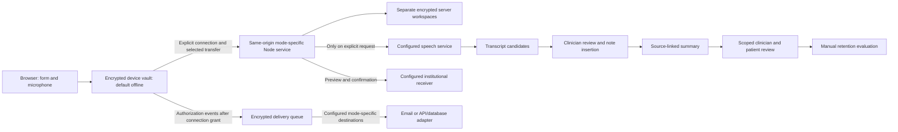

# Architecture and template mapping

## Patient workspace

The sidebar has Dashboard, Patients, Data and Settings. The patient context remains visible while switching Clinical notes, Review/handoff and optional Reflection. Daily entry is the default. Clinical tabs are ordered History/background, Daily review, Clinical course, Tests/results; voice is optional. Voice, Memos and Tasks are patient-scoped auxiliary panels; a daily shortcut and course memo references reuse the same records. Voice drafts are encrypted `voiceDraft` records, excluded from clinical exports and summaries; text memos are clinical `memo` records. The dashboard patient table reads the same records, without a second census store. Patient review views and the dashboard queue reference the same records. Prior daily notes are read-only comparisons until explicitly opened for editing.

New reflections reference the current encounter. Legacy unlinked entries remain accessible from the dashboard and can be explicitly linked once with version validation and revision history. Clinical JSON, email drafts, receiver payloads, draft exports and summaries exclude reflections; encrypted full-workspace backups retain them. Clinical object fields are retained. Version 0.6.0 adds separate encrypted server tables for sync staging and authorization delivery, plus independent browser IndexedDB stores.

## Worksheet layout and localization

The browser follows the Chinese b and English V006b paired-column paper layout, stacking fields on phones in all eight locales. Initial contact/source fields follow family/social history; the second section holds vitals, ROS/examination, reproductive/function history, prevention, prominent results and assessment/plan. Daily review follows course, selected trends, medication/device and examination, problem plans, safety/discharge, tasks and handoff. Persistent background is inside History/background.

`worksheet-ui.js` groups entered result values by exact metric and unit and keeps the latest three through the note date. Different units are never silently converted or combined. Hospital day is calendar-based, with admission as day 1; invalid/future dates display no number.

`languages.js` is the client/server locale registry; `locale-core.js`, `i18n.js`, `translations.js` and `locales/` translate developer-owned UI strings. The `ui` tagged template translates only literal fragments; interpolated clinical values are never passed through it for translation. Browser preferences use `wardnote-language` and `wardnote-panel-layout` for language and coordinates only; API responses are not put in the service-worker cache. Encrypted clinical and audio copies are explicitly persisted in mode-separated IndexedDB device vaults. Switching flushes pending edits; recording guards cross-patient changes, not same-patient navigation. Existing clinical text, JSON records, transcripts and stored summaries remain in their authored language. Optional candidate generation uses a separate report language; translated summary generation creates a new record retaining source compilation, provenance, generation language and direction. Locale-specific confirmation phrases map to the same explicit server-side send/cleanup confirmations. See [localization](LOCALIZATION.md) for translation review and speech capability boundaries.

No clinical-record rewriting is needed. Stable note field IDs retain all previous data; `initial.fields.vitals` is additive. Old vital information in examination text remains where it was entered. Printing uses the displayed worksheet groups in the selected UI language while preserving clinical text. Long content can continue over more A4 pages; it is not forced into a fixed two-page form.

## Optional models

See [MODEL-INTERFACES.md](MODEL-INTERFACES.md). Speech and text services are independent. Text responses are validated, limited to known sections, and never applied automatically. Note insertion and voice-draft consumption commit together with version and encounter checks. Model errors leave the source intact.

## Data flow

## Clinical objects

New stage summaries include `pendingTaskSnapshot` with encounter ID, UTC as-of time and outstanding-task IDs. Narrative records retain the selected date range; outstanding tasks are a separate current snapshot, including earlier/later tasks outside that range. Each included task retains its source version and next-step/contact details. Added, removed or changed pending tasks invalidate current review eligibility. Summary editing cannot replace the original snapshot metadata or source bindings. Older summaries without this metadata retain their original behavior and text; regenerate explicitly to obtain the new coverage. Discharge reminders read the existing task records and do not mutate them.

Institution-owned identity authorization, access control and attributable audit governance are deployment responsibilities, not additional product administration modules. Current local authentication, encryption and revision/event history remain supporting safeguards; they are not per-person institutional identity or audit attribution. See [scope](CLINICAL-SCOPE.md) and [deployment](DEPLOYMENT.md).

| Object | Meaning |
| --- | --- |
| Encounter | One care episode, dates, patient label, service, allergies, code status and attention level |
| Initial note | History source, HPI, prior history, medications, allergies, family/social history, function, examination and key results |
| Daily note | Interval course, complete vital/oxygen/fluid review, drugs/devices, key results, safety, discharge planning and communication |
| Problem | Assessment, supporting/opposing evidence, alternatives, plan, monitoring and if–then escalation |
| Background | Longitudinal context reviewed separately from daily changes |
| Lab / task | Original result and source; owner, deadline and completion |
| Recording | Encrypted chunks, original format, completion state, review flags and retention protection |
| Summary | Existing material plus source record IDs and versions; no model-generated diagnostic inference |
| Review / resolution | Scoped patient participation and subsequent handling of corrections |
| Reflection | Optional learning entry, intended to omit identifying details |

Initial and inpatient mappings originate in `templates/initial-history-v006b.docx` and `templates/inpatient-management-v006b.docx`; continuation and reflection remain optional. UI field definitions live in `app/public/domain.js`. Clinical content was not changed during public-package preparation.

## Review and retention

Editing a reviewed clinical record cancels its current review. A summary records source versions; changed sources require regeneration and review. Patient participation is attached to a specific summary version and is documented by the clinician. It does not authenticate the patient or endorse professional diagnoses.

Fourteen days is a configurable evaluation threshold, not an automatic deletion timer or institutional policy. Important clips, holds and unfinished recordings are protected. Ordinary audio additionally requires source review, no further listening need, a reviewed linked note, a current reviewed summary and no unresolved patient corrections. The server checks the whole selected batch again before cleanup. Deleted audio leaves metadata and confirmed clinical text; old backups are unchanged.

## Storage and trust

Node's built-in HTTP(S), crypto and SQLite modules provide the service. Record payloads, revisions and audio use AES-256-GCM; scrypt derives a password key that wraps a random data key. No third-party runtime package is required. IDs, object types, timestamps and sizes remain visible metadata. Keys and viewed data exist in process memory while unlocked.

Session cookies are HttpOnly/SameSite; mutations require an origin check and a session CSRF token. Default binding is loopback. Non-loopback startup requires TLS and an explicit origin. The PWA caches program resources only, never API responses. None of these controls substitutes for institutional SSO/RBAC, access review, independent security testing or certified signatures.

Each account-mode workspace uses record-version conflict detection. Browser writes are serialized by Web Locks; conflicting clinical edits preserve the unsaved draft. Personal and institutional vaults, server credentials and authorization recipients are independent. A browser mode cannot be switched while logged in, including opposite-mode sessions in another tab. The application is not a multi-tenant platform. The audit hash chain is local and does not provide independently immutable storage. A compromised server can access unlocked information.

Original audio clips are decoded and resampled to independent 16kHz mono PCM WAV. They preserve a listening excerpt and source range, not the original compressed bitstream byte-for-byte.

## Institutional workflow boundary

Optional prompts help record consciousness, monitoring frequency, escalation criteria and critical-result follow-up in existing fields. The task detail helper includes accessible explanatory text without changing stored data. Tasks retain pending/completed states. Formal orders, approvals and governance remain institutional responsibilities; see [Clinical workflow boundaries](CLINICAL-SCOPE.md).

## Device persistence and transfer

`offline-store.js` owns encrypted IndexedDB state and audio; AES-256-GCM keys are randomly generated and wrapped using PBKDF2-SHA-256 (600,000 iterations) with a per-vault salt. Keys exist only while unlocked. `offline-api.js` supplies the clinical interface locally using the shared record validator. `offline-sync.js` keeps explicit per-page connection authorization, previews selected records, compares stored bases and rechecks conflicts before commit. `offline-ui.js` presents mode selection, confirmation, storage and transfer controls. Server `sync-service.mjs` commits selected records/audio atomically, verifies hashes and never silently replaces conflicting audio.

`authorization.mjs` persists fixed-schema, credential-free events before attempting mode-specific HTTPS destinations. Delivery retries use idempotency keys and remain visible as pending until acknowledged. Browser events are not independently attested identities or tamper-proof institution audit records. See [operating details and limits](OFFLINE-AND-ACCOUNTS.md).

`backup-segments.js` processes encrypted device state/audio into bounded parts, with a password-authenticated manifest written last. Restore verifies the set, decrypted state and every audio chunk before committing vault metadata/state and publishing the account. Audio is staged only in an unused target account; failed attempts clear staging, and interrupted unpublished attempts are cleaned on the next restore/setup for that target. Verification-only does not write to the workspace. Legacy single-file restore remains supported. Filenames, counts and vault metadata are not secret; clinical payloads/audio remain encrypted. This is a device backup format, separate from encrypted SQLite server snapshots. See [backup operation and limits](OFFLINE-AND-ACCOUNTS.md).

## Program resource updates

Version 0.6.15 checks the service-worker registration at startup, on foreground/network recovery and every five minutes while visible. Login and Settings also expose a manual check. Notices distinguish an available release, a completed check, a failed check and an incomplete download. Choosing Later leaves the current working page in place; detection itself never requests clinical data or changes connection authorization.

From 0.6.12, `update-controller.js` exposes a waiting service worker through an explicit apply action. The page blocks recording, unfinished forms and active operations, freezes interaction and flushes pending saves before requesting activation. The worker checks for other same-origin windows before this requested activation; users close other browser/PWA windows first. The browser can also activate a prepared worker through its normal lifecycle after all old pages close. Initial installation still prepares offline use. Application data, account keys and connection authorization are not sent in this coordination message.

Each worker serves its own complete program cache. A missing resource returns an unavailable response rather than fetching a potentially different release's module from the server. Failed installation removes only its incomplete new cache; it does not remove the active cache or clinical storage. Retention is the current and up to two prior program caches, not a data backup or general database downgrade mechanism. The program cache contains only allowlisted shell resources, never API responses or encrypted clinical databases.

New shell downloads bypass stale HTTP cache entries. Deploy the full verified package as one consistent release; do not expose files from multiple releases during an in-place upload. Program-cache availability alone does not prove that an administrator deployed a coherent release. Preserve the origin and all clinical storage during replacement.

An explicit redownload action repairs an incomplete waiting candidate's program cache. It does not clear clinical storage, modify the active release's data or automatically activate the candidate; the normal save-and-apply checks still apply.

The legacy 0.6.11 worker and page lack the new waiting/apply behavior. First upgrade from, or rollback to, that version requires saved work and closure of all app windows. Compatibility claims remain scoped to tested releases and synthetic records; [release instructions](RELEASING.md) distinguish source rollback from restoring older patient data.
