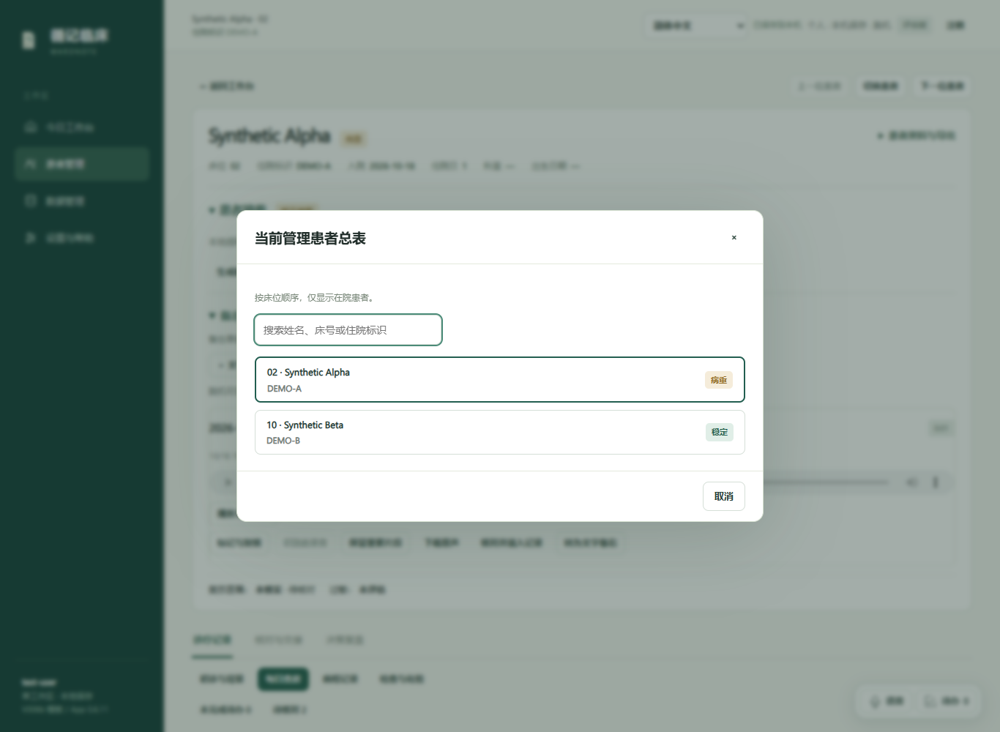
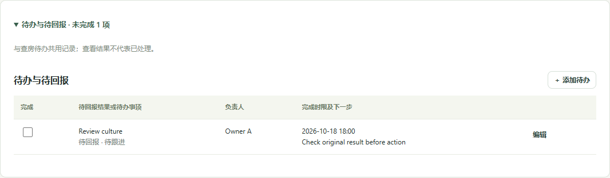
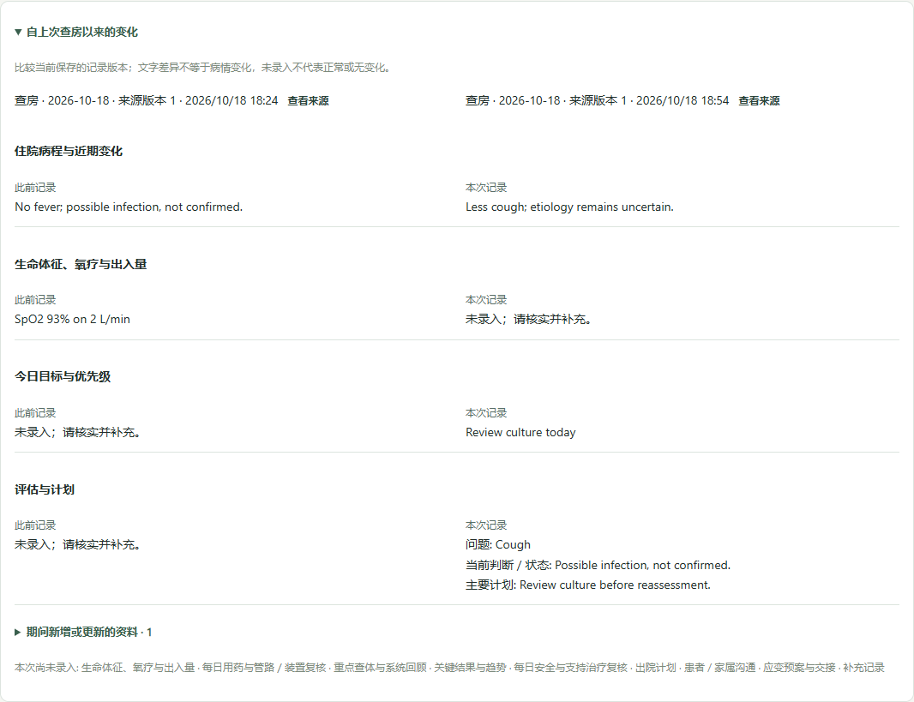
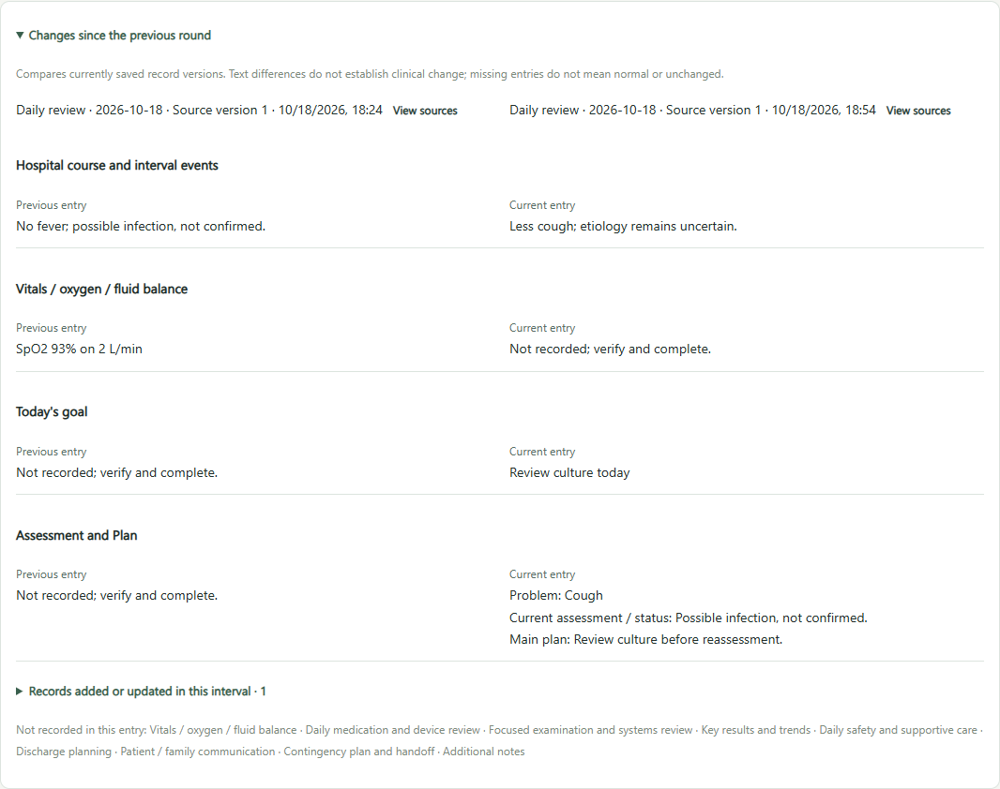
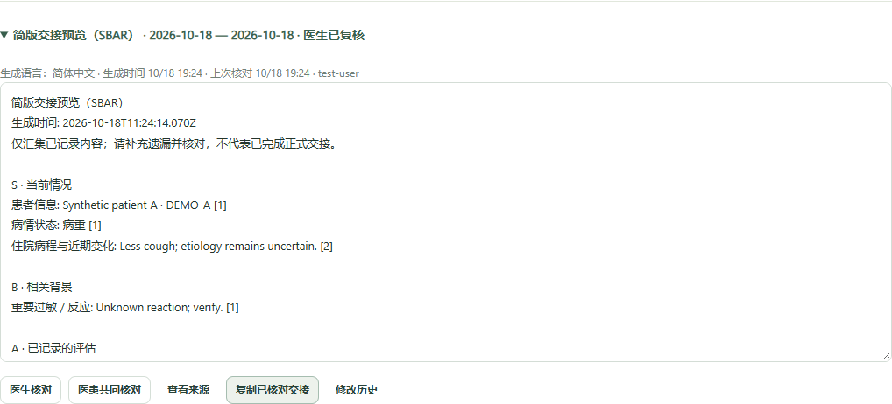
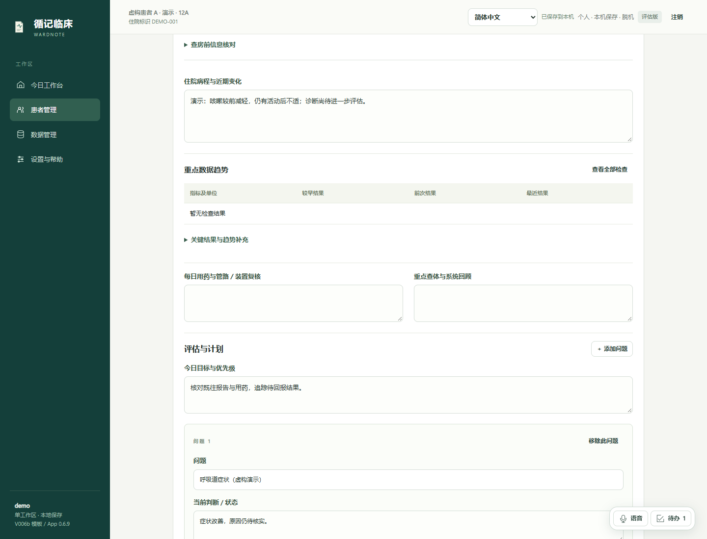
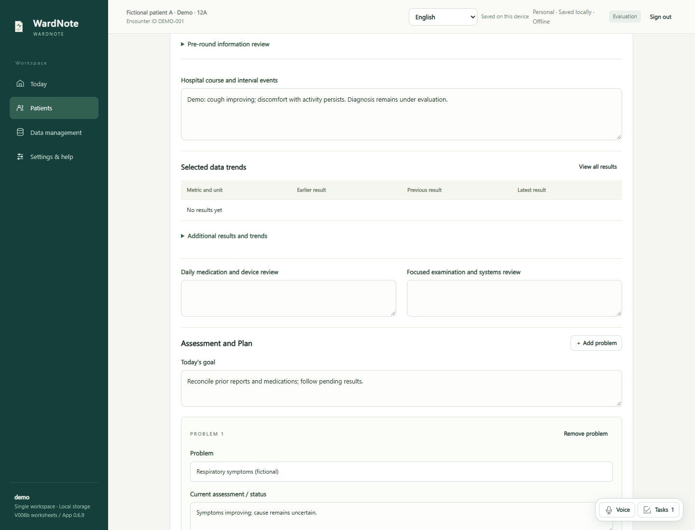
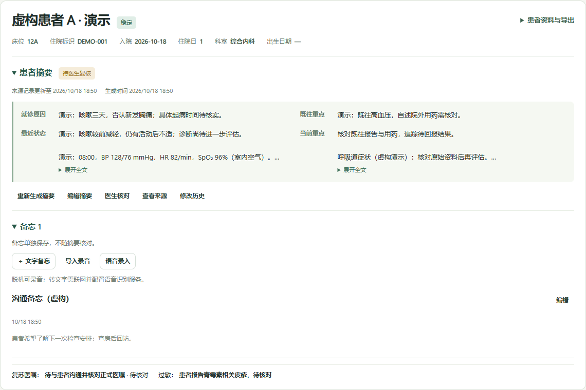
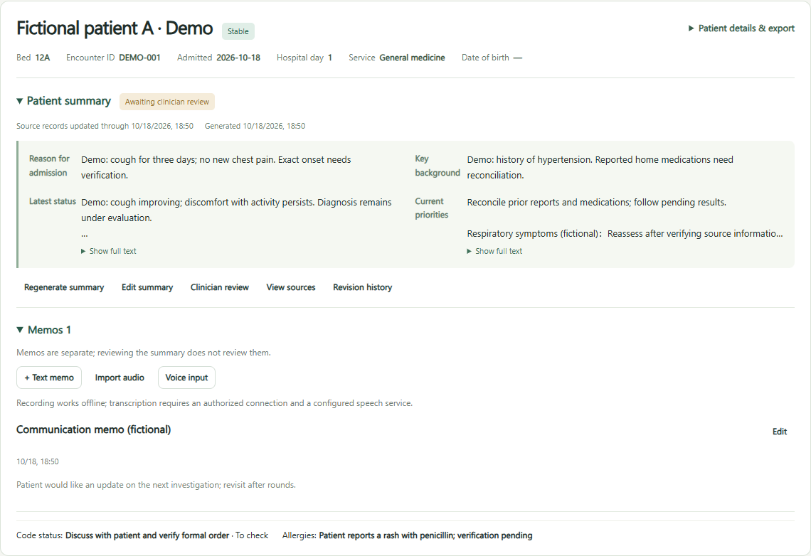

# Update and backup guidance / 更新与备份说明

Version **0.6.12** · 2026-10-18. Update prompts wait for explicit saving and confirmation; encrypted multipart backup offers separate verification and new-account recovery. See [validation and limits](VALIDATION.md) and [steps](OFFLINE-AND-ACCOUNTS.md). The screenshots below remain historical examples labeled with their original versions.

本版新增更新提示和分卷备份/核验流程；界面检查使用虚构资料。下列旧版截图保留原版本，不改标为本版截图。

---

# Bedside navigation demonstration / 床旁导航演示

Version **0.6.11** · 2026-10-18. Fictional patients and simulated review only; not clinical validation.

患者列表在当前患者页内搜索和切换；交接页的折叠清单复用同一份待办。下方保留 0.6.10 及 0.6.9 的历史示例，不将旧图标为本版截图。

The searchable inpatient list and collapsible handoff tasks reuse existing patient data. Older screenshots below retain their original version labels. Authored clinical text is not translated when the interface language changes.

---

# Continuity demonstration / 连续查房演示

Version 0.6.10 · 2026-10-18. Isolated fictional records only; not clinical validation.

两个新增入口仍以本机既有记录为来源。下方核对状态为自动测试中的模拟医生核对，不代表实际临床审核。界面切换保留原文；中英文混合的临床示例不是漏译。

The review shown is a synthetic test action, not clinical sign-off. Original record wording is retained across UI languages. [Workflow and scope](CONTINUITY.md).

---

# Fictional workflow demonstration / 虚构病例演示

Version 0.6.9 · 2026-10-18. All names, identifiers and clinical text below were created solely for this demonstration. No real patient records, recordings, institutions or model services were used. These are historical 0.6.9 screenshots of the preceding application, not a clinical validation study.

以下为独立演示工作区截图，所有病例均属虚构。摘要保留“待医生复核”状态；手工输入的示例不作为诊疗建议。中英文截图分别使用独立的虚构病例，切换界面语言不会自动翻译患者资料。

## 1. Patient list / 当前患者总表

Locate patients by bed, check today's note status and follow open tasks. / 按床位定位患者，查看今日记录状态与未完成事项。

## 2. Daily round / 每日查房（局部）

Record interval events and problem-based assessment/plan; keep source uncertainty visible. / 记录病程变化、评估与计划，保留原文中的不确定性。

## 3. Brief and memos / 四项速览与独立备忘

Generate a local four-field brief; inspect its source and review it explicitly. Memos remain independent. Audio capture is available offline; transcription requires separately authorized and configured services. / 摘要可查看来源、人工修改并经医生核对；备忘独立保存。脱机录音不等于脱机识别。

To try the built-in demo: start a separate evaluation workspace, create a local account and choose “Load fictional demo patients”. End any recording and wait for saving before exiting. Review [getting started](GETTING-STARTED.md), [validation limits](VALIDATION.md) and [follow-up checks](RELEASE-CHECKLIST.md). Apply the [license](../LICENSE) to any evaluation; institutional evaluation requires written authorization.

体验方式：在独立评估工作区建立本机账号，选择“载入虚构演示病例”；退出前结束录音并等待保存。机构评估仍须遵守项目许可，不代表可直接部署至真实临床环境。
